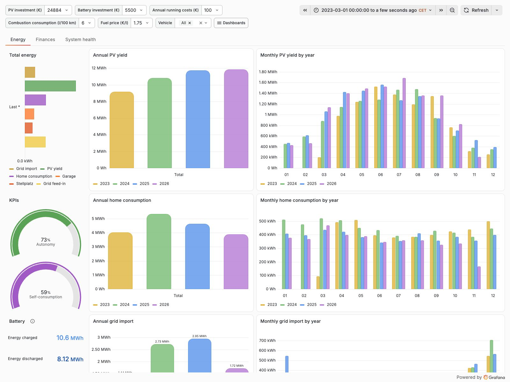
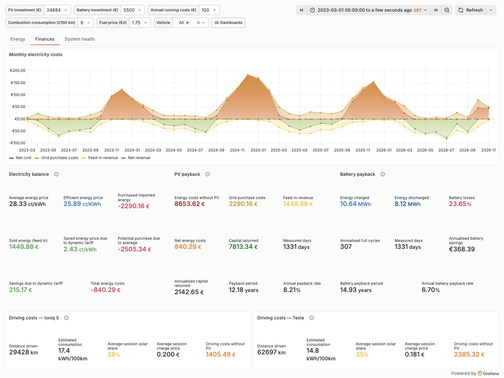
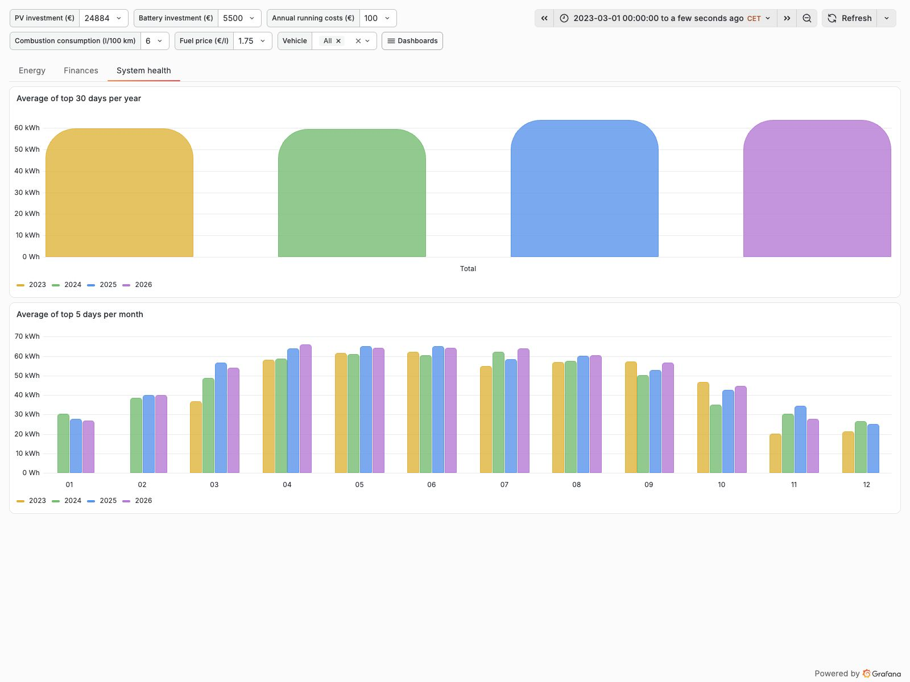
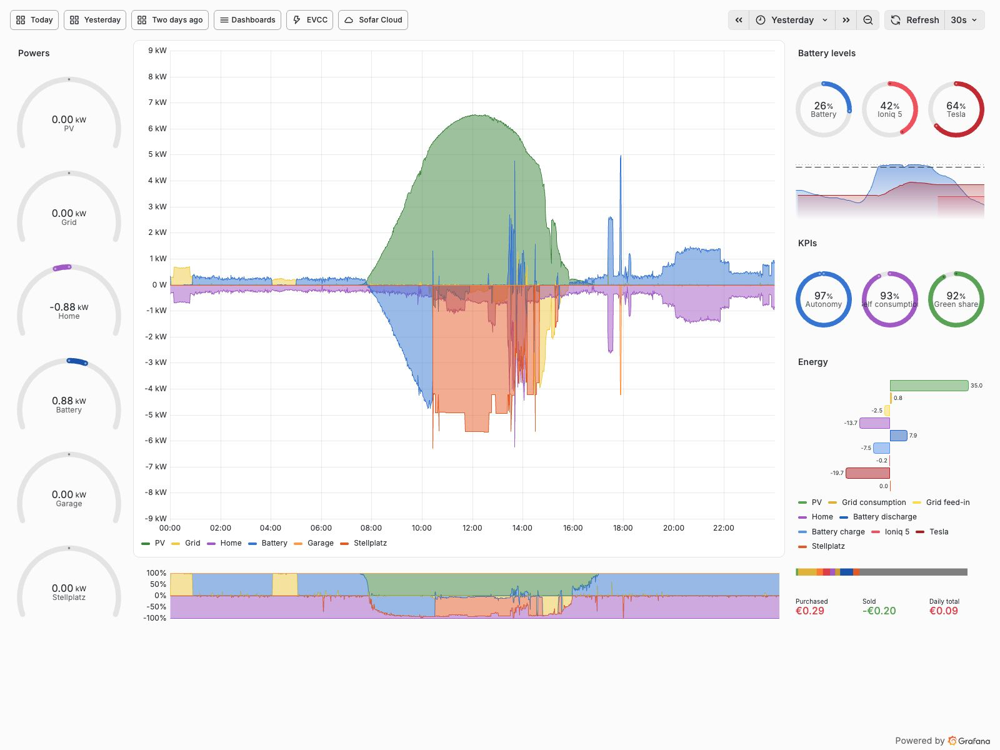
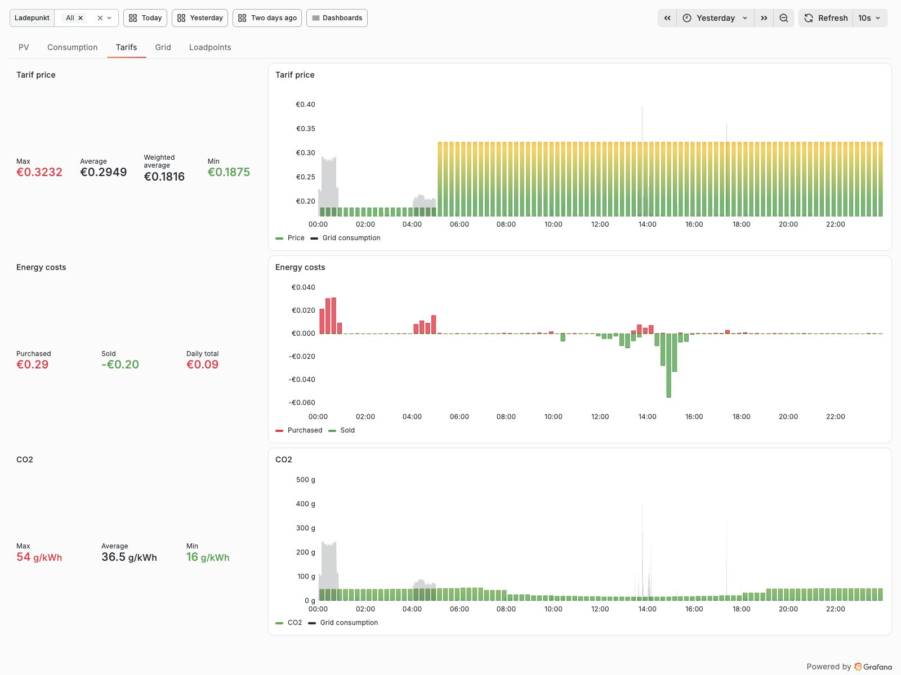
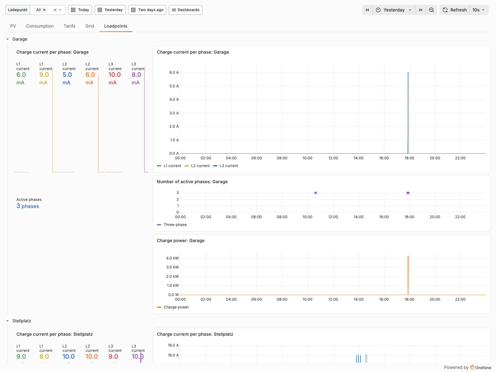
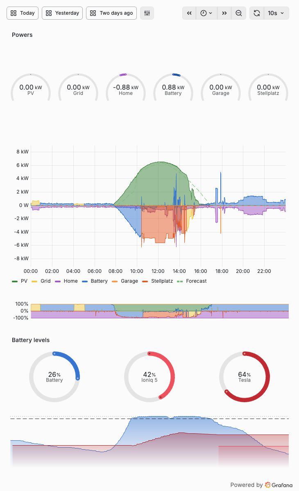
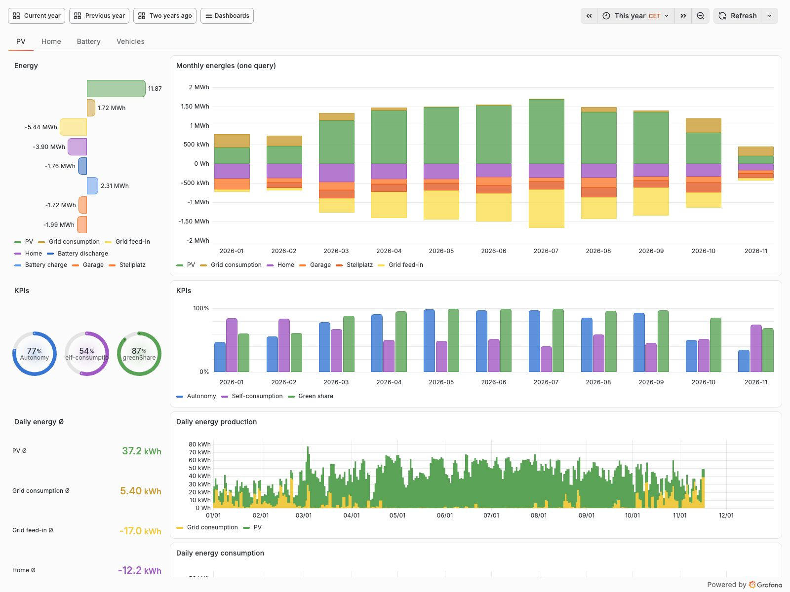
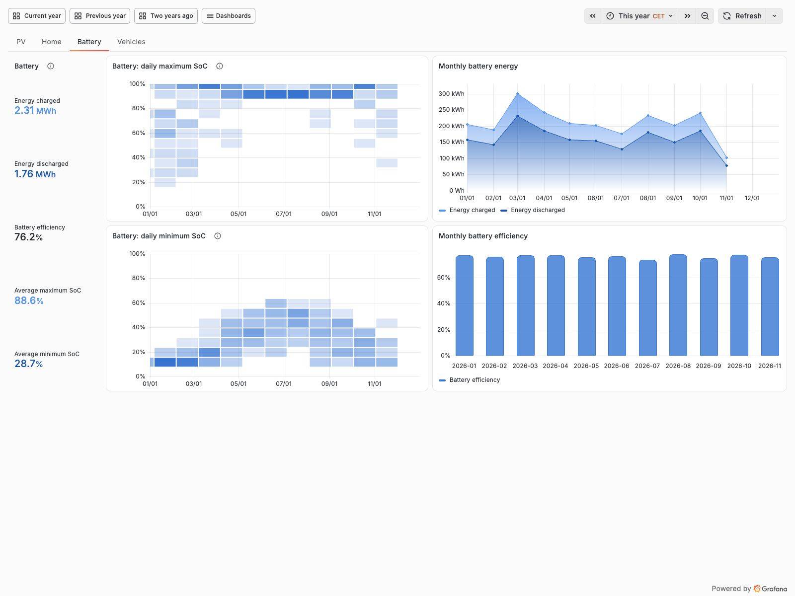

# Dashboard

## EVCC: All-time

### Energy

### Finances

### System health

## EVCC: Month

### PV

### Home

### Costs

### Battery

## EVCC: Today

## EVCC: Today - Details

### PV

### Consumption

### Tarifs

### Grid

### Loadpoints

## EVCC: Today - Mobile

## EVCC: Year

### PV

### Home

### Battery

### Vehicles

