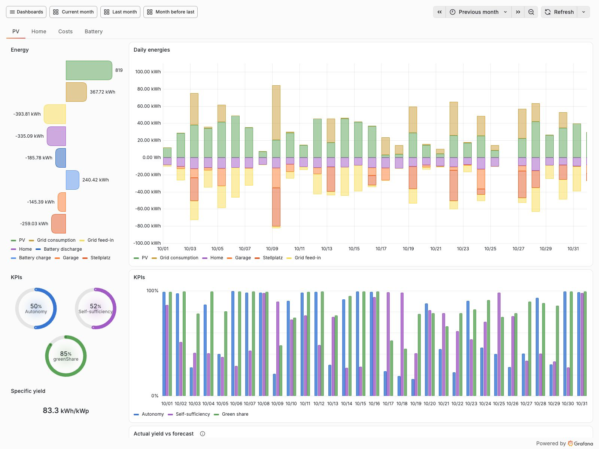
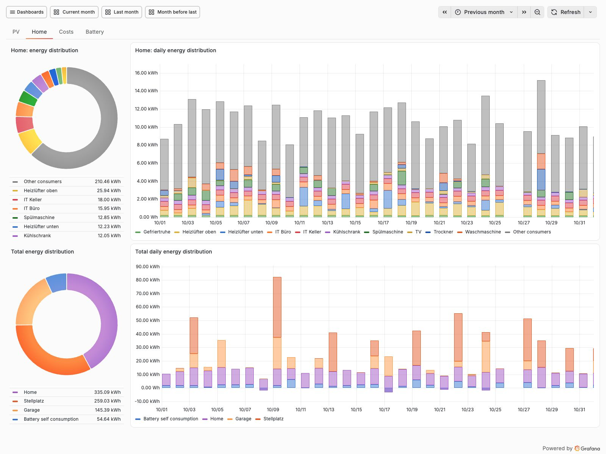
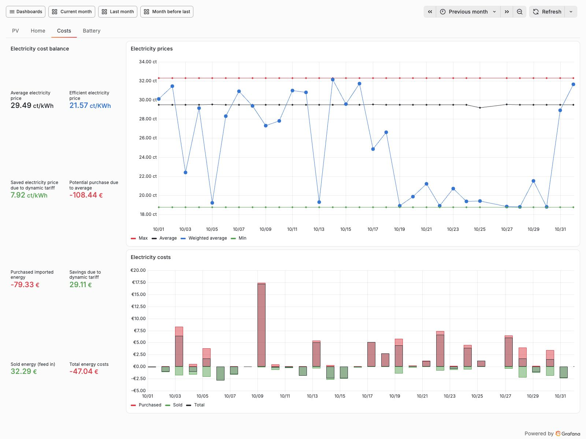
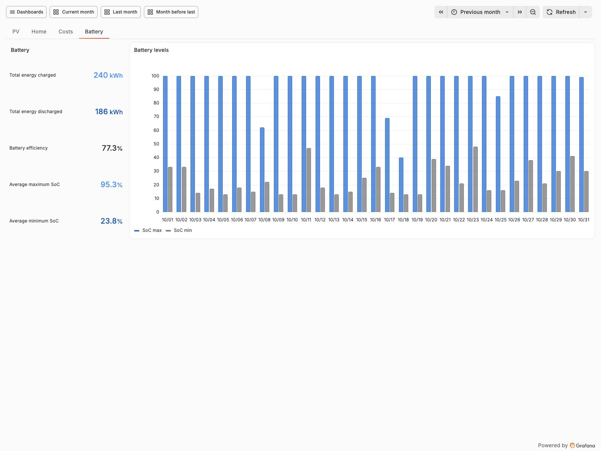
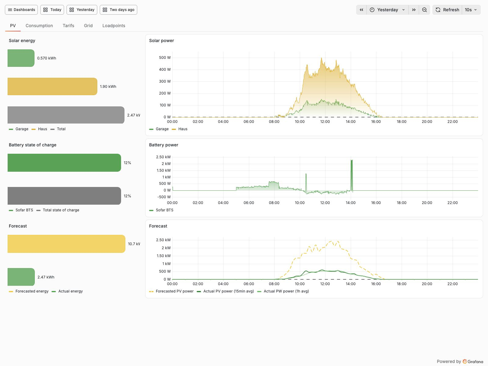
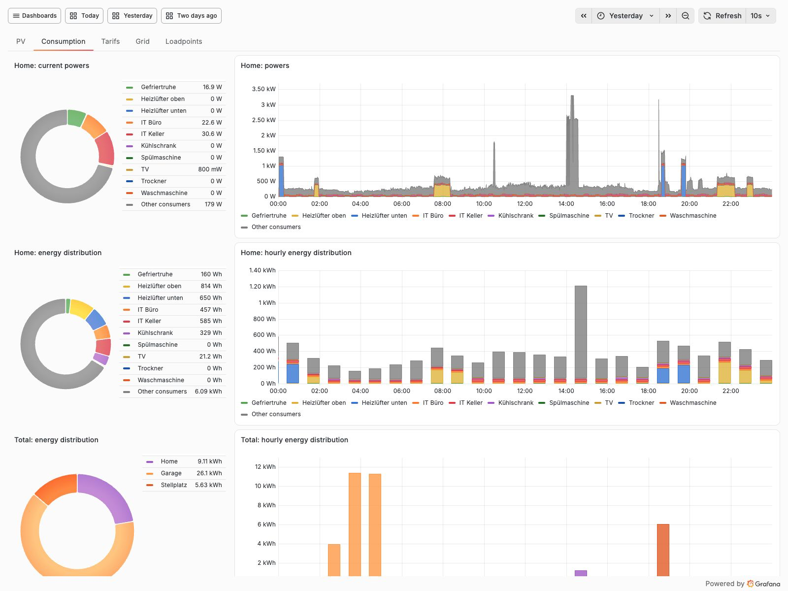
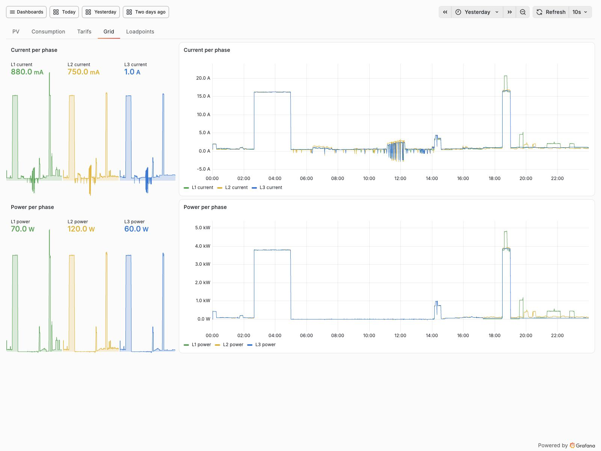
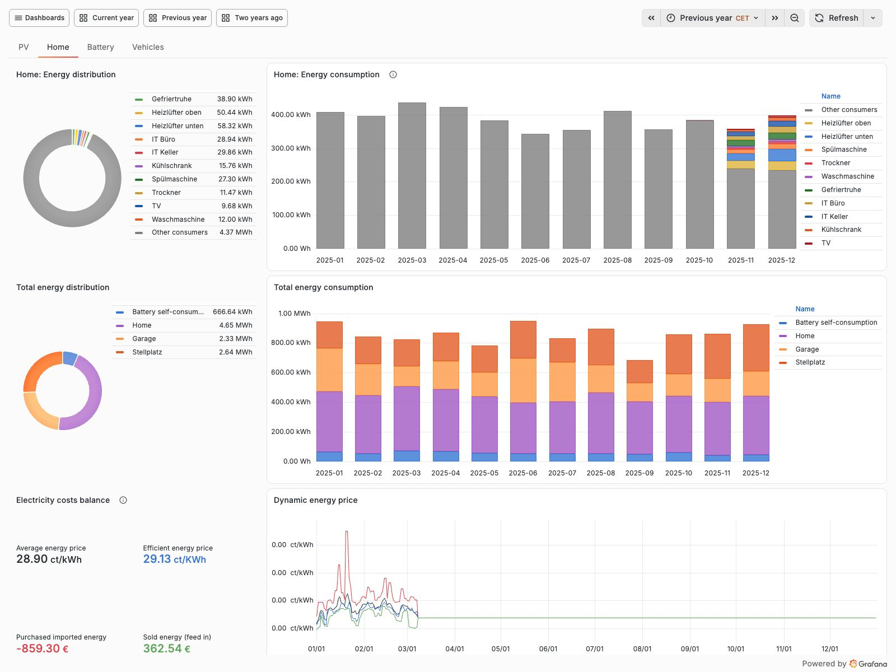
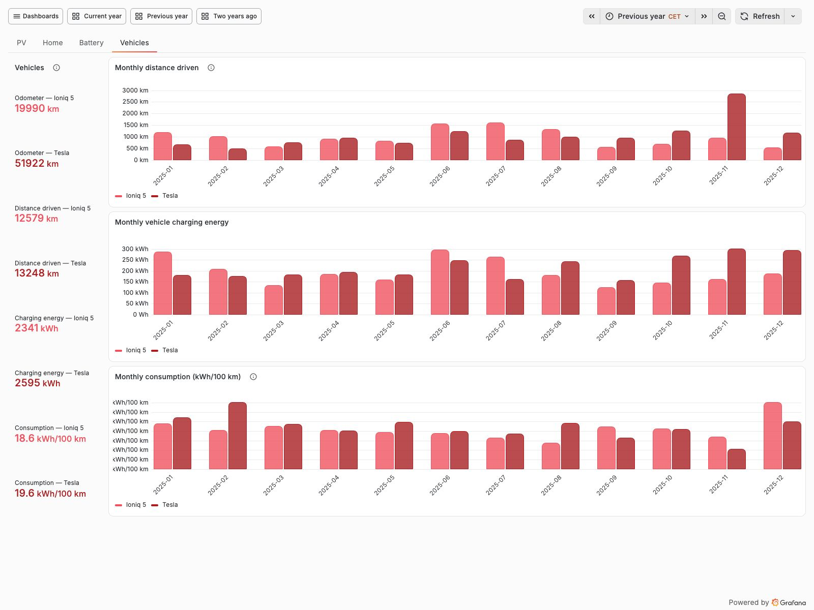

# Dashboard

## EVCC: All-time

### Energy

Long-term energy totals, annual and monthly PV yield, home consumption, autonomy, and battery performance since March 2023.

### Finances

Monthly electricity costs, cumulative electricity balance, PV and battery payback, and vehicle driving costs over the saved all-time period.

### System health

Yearly averages of the 30 highest-yield days and monthly averages of the five highest-yield days compare PV performance across years.

## EVCC: Month

### PV

Energy totals and daily flows for the current calendar month, alongside autonomy, self-sufficiency, green share, and specific PV yield.

### Home

Household consumers and overall energy use for the current month, shown as distribution charts and daily stacked consumption bars.

### Costs

Electricity purchase costs, feed-in revenue, dynamic tariff savings, and daily price and cost trends for the current month.

### Battery

Battery charging and discharging totals, efficiency, average state-of-charge limits, and daily minimum and maximum charge levels for the current month.

## EVCC: Today

Today’s real-time power flows, battery and vehicle charge levels, energy totals, and electricity costs in the desktop overview.

## EVCC: Today - Details

### PV

Today’s solar energy and power by array, battery charge and power, and comparisons of actual PV output with the forecast.

### Consumption

Today’s household power and energy use by consumer, with distribution charts and hourly consumption profiles.

### Tarifs

Today’s tariff prices, grid purchase and feed-in costs, and CO₂ intensity, with time-series comparisons against grid consumption.

### Grid

Grid current and power on each phase, with real-time summary values and today’s current and power profiles.

### Loadpoints

Today’s charging currents, active phases, and charging power for the Garage loadpoint, with the beginning of the Stellplatz section below.

## EVCC: Today - Mobile

Today’s real-time power gauges and daily power-flow chart in the mobile layout, followed by battery and vehicle charge levels.

## EVCC: Year

### PV

Energy totals, monthly energy flows, autonomy, self-consumption, and daily production for the current calendar year.

### Home

Household and total energy distribution and monthly consumption for the current year, with electricity cost and price panels beginning below.

### Battery

Battery energy totals and efficiency for the current year, with charge-level heatmaps and monthly charging, discharging, and efficiency trends.

### Vehicles

Vehicle odometers, annual distance and charging energy, and monthly distance, charging, and consumption comparisons for the current year.

