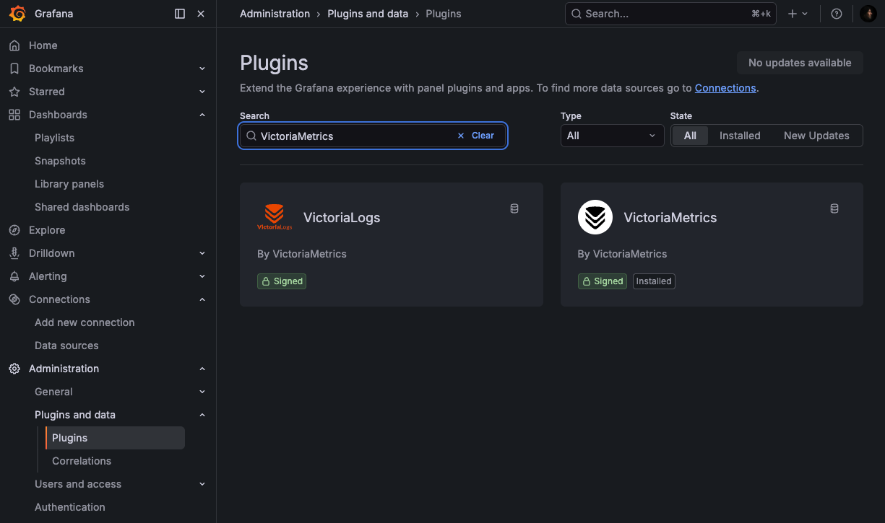
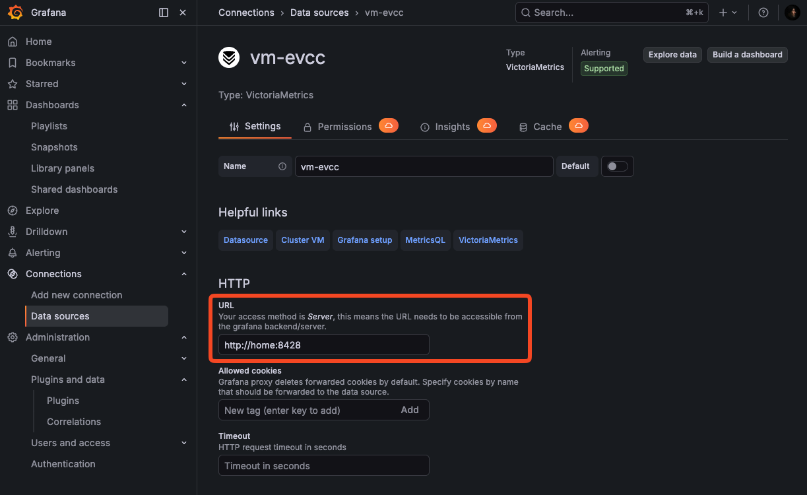
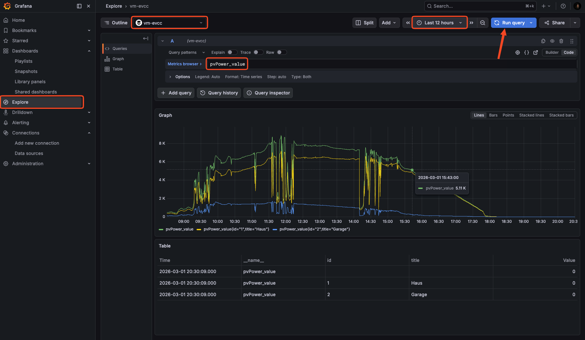

# Installation

This guide describes how to install the Grafana dashboards.

## Prerequisites

### Victoria Metrics

There are several installation methods. Regardless of which you choose, it's important to increase the default retention period.

For detailed instructions, see [vm-installation.md](./vm-installation.md).

### EVCC

If you've reached this point, you likely already have EVCC installed. If not yet done, I personally recommend the installation via a docker image on a Raspberry PI or similar Linux based servers. This would be more consistent with the my recommendations on how to install Victoria Metrics and Grafana.

For completeness, here is the [link to the installation guide](https://docs.evcc.io/docs/installation).

### Connect EVCC to Victoria Metrics

See also the [EVCC documentation](https://docs.evcc.io/en/reference/configuration/influx/#victoriametrics).

1. In EVCC open 'More > Configuration'
2. Under Integrations configure the InfluxDB integration (yes! This is correct also for Victoria Metrics)
3. Enter these values:
   - URL: `http://<hostname>:8428`
   - Organization: `evcc`
   - Bucket: `evcc`
   - Leave the API Token empty. 
4. Save the changes and then restart EVCC.

### Grafana

Grafana can be easily installed using docker or your Linux distribution's package manager.

Be sure to use the open source version (Grafana OSS).

My recommended way is to run Grafana with Docker, as described in the official [Grafana Docker installation guide](https://grafana.com/docs/grafana/latest/setup-grafana/installation/docker/).

Installation instructions for all major Linux distributions [are available from Grafana](https://grafana.com/docs/grafana/latest/setup-grafana/installation/). For Raspberry Pi, follow the [APT repository installation guide](https://grafana.com/docs/grafana/latest/setup-grafana/installation/debian/#install-from-apt-repository).

Finally, [start the Grafana server](https://grafana.com/docs/grafana/latest/setup-grafana/start-restart-grafana/).

## EVCC Grafana dashboards

Now, proceed with the actual dashboard installation.

### Configure the VictoriaMetrics data source

1. In Grafana, go to 'Administration > Plugins and data > Plugins', search for the 'VictoriaMetrics' plugin, and install it.

   
   
1. Under `Connections > Data sources`, create a new connection to your database. In the 'URL' field, enter `http://<server>:8428`. Scroll to the bottom and click `Save & test`.

   

1. You can now use Grafana Explore to view the imported data. Select the data source you just created at the top, set the time range to a meaningful period, and in the 'Metric browser', select a metric such as `pvPower_value`. Click 'Run query' to view the imported data.

   

### Import the dashboards

1. In Grafana, open **Dashboards** → **New** → **Import**.
2. Upload a dashboard JSON file from one of these folders:
   - English dashboards: [`dashboards/src/en`](./dashboards/src/en/)
   - Localized dashboards: [`dashboards/translations/<language>`](./dashboards/translations/)
3. Select the VictoriaMetrics data source when prompted, then click **Import**.
4. Fill out or adapt the parameters of the dashboard.
5. Repeat for each dashboard you want to use.

Open an imported dashboard and verify that it displays data for the selected time range.

## EVCC Grafana aggregation script

The dashboards require an aggregation script that regularly aggregates the data. See the [README.md in the scripts folder](./scripts/README.md) for more information on how to configure and install this.
