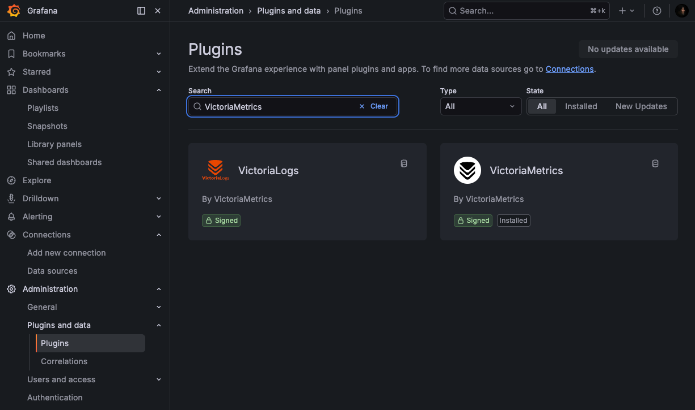
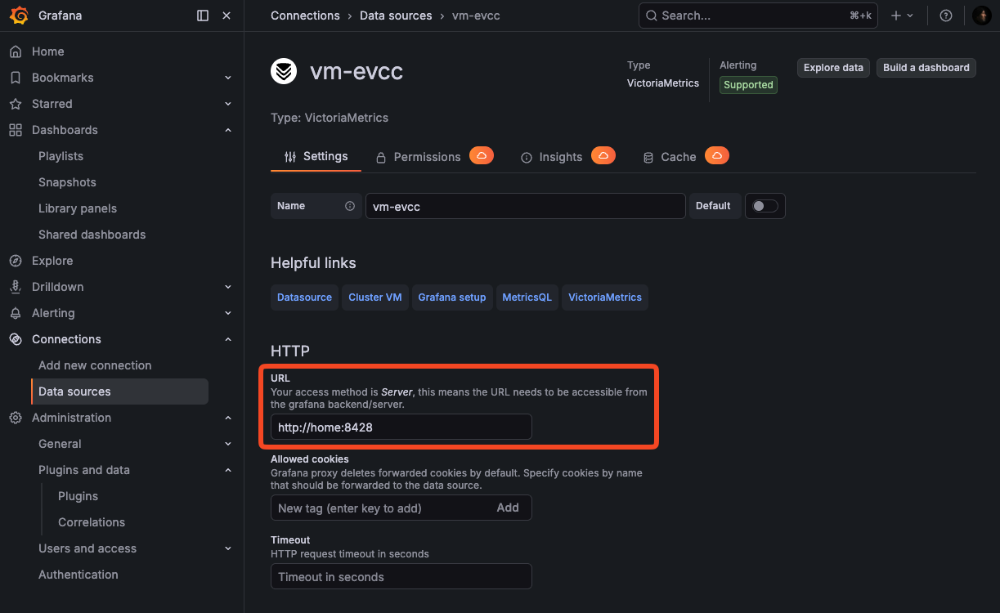
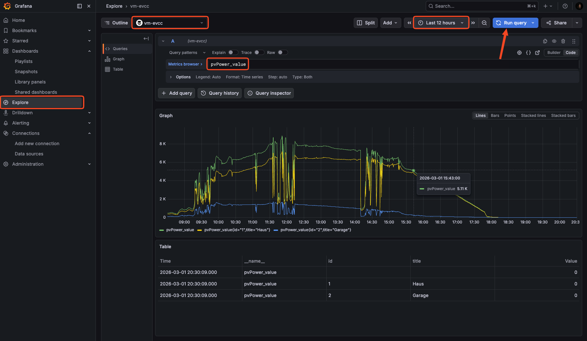

# Migration

This guide describes how to migrate from Influx 1.8 (with or without the old dashboards, version 1.x or earlier) to Victoria Metrics with the new dashboards (version 2.x).

## Step overview

Recommended migration with prior testing:
- Test new dashboards:
   1. Install Victoria Metrics.
   1. Migrate data from Influx 1.8 to Victoria Metrics.
   1. Install the new Victoria Metrics-based dashboards alongside the old dashboards.
   1. Install and run the aggregation script.
   1. Test the new dashboards.
- Do the switch:
   1. After successful testing, reconfigure EVCC to write data to Victoria Metrics.
   1. Re-import data from Influx 1.8 to Victoria Metrics so that any data written since step 2 is also available in Victoria Metrics.
   1. Run the aggregation script again.
   1. Delete the old dashboards and library panels.

Optimistic migration:
1. Install Victoria Metrics.
1. Reconfigure EVCC to write data to Victoria Metrics instead of Influx DB.
1. Import data from Influx 1.8 to Victoria Metrics.
1. Install the new Victoria Metrics-based dashboards.
1. Install and run the aggregation script.
1. Delete the old dashboards and library panels.

See also the note below about Telegraf, which allows you to run the old Influx based dashboards and the new Victoria Metrics based dashboards in parallel.

## Installing Victoria Metrics

There are several installation methods. For all of them, it is important to increase the retention period.

For installation details, see [vm-installation.md](./vm-installation.md)

## Migration

> [!IMPORTANT]
> Before you start the migration make sure that you have properly set the `retentionPeriod` parameter as described in the [Victoria Metrics installation](./vm-installation.md) guide.

1. In earlier versions of Influx, the measurement `batteryControllable` was written. This did not contain valid numbers as a metric and must be deleted before migration.
   ```bash
   influx -database evcc -execute 'drop measurement batteryControllable'
   ```
   You may need to adjust the database name, and the parameters `-username <user>` and `-password <password>` may also be required.
1. Start importing data from Influx DB using the following commands assuming that you have given the Influx database for storing the data from EVCC the name `evcc`. Change the database name in the following commands in case you have used a different database name:
   - Docker installation
      ```bash
      sudo docker run -it --rm victoriametrics/vmctl:latest influx --influx-addr=http://127.0.0.1:8086 --influx-database=evcc --vm-addr=http://127.0.0.1:8428 --influx-skip-database-label
      ```
      If a username and password are required for Influx:
      ```bash
      sudo docker run -it --rm victoriametrics/vmctl:latest influx --influx-addr=http://127.0.0.1:8086 --influx-database=evcc --influx-user <user> --influx-password <password> --vm-addr=http://127.0.0.1:8428  --influx-skip-database-label
      ```
      Adjust `<user>` and `<password>` as needed.

   - Local installation
      ```bash
      vmctl influx --influx-addr=http://127.0.0.1:8086 --influx-database=evcc --vm-addr=http://127.0.0.1:8428  --influx-skip-database-label
      ```
      If a username and password are required for Influx:
      ```bash
      vmctl influx --influx-addr=http://127.0.0.1:8086 --influx-database=evcc --influx-user <user> --influx-password <password> --vm-addr=http://127.0.0.1:8428  --influx-skip-database-label
      ```
      Adjust `<user>` and `<password>` as needed.

## Connect EVCC to Victoria Metrics

> [!TIP]
> Want to validate the VictoriaMetrics dashboards before switching EVCC from InfluxDB? You can run both databases in parallel by placing Telegraf between EVCC and the databases: configure EVCC's InfluxDB integration to send data to Telegraf's InfluxDB listener, then configure Telegraf to forward the metrics to both your existing InfluxDB instance and VictoriaMetrics.
>
> See Telegraf's [InfluxDB listener](https://docs.influxdata.com/telegraf/v1/input-plugins/influxdb_listener/), [InfluxDB output plugin](https://docs.influxdata.com/telegraf/v1/output-plugins/influxdb/), and [example for routing metrics to multiple outputs](https://docs.influxdata.com/telegraf/v1/examples/route-metrics/). VictoriaMetrics documents [how to configure Telegraf to write using the InfluxDB protocol](https://docs.victoriametrics.com/victoriametrics/integrations/influxdb/).

See also the [EVCC documentation](https://docs.evcc.io/en/reference/configuration/influx/#victoriametrics).

1. In EVCC open 'More > Configuration'
2. Under Integrations configure the InfluxDB integration (yes! This is correct also for Victoria Metrics)
3. Enter these values:
   - URL: `http://<hostname>:8428`
   - Organization: `evcc`
   - Bucket: `evcc`
   - Leave the API Token empty. 
4. Save the changes and then restart EVCC.

## Grafana setup
1. In Grafana, go to 'Administration > Plugins and data > Plugins', search for the 'VictoriaMetrics' plugin, and install it.

   
   
1. Under `Connections > Data sources`, create a new connection to your database. In the 'URL' field, enter `http://<server>:8428`. Scroll to the bottom and click `Save & test`.

   

1. You can now use Grafana Explore to view the imported data. Select the data source you just created at the top, set the time range to a meaningful period, and in the 'Metric browser', select a metric such as `pvPower_value`. Click 'Run query' to view the imported data.

   

> [!NOTE]
> Metrics imported from Influx are now found under `<Influx Measurement Name>_<Value>`, where `<Value>` is usually 'value' for most measurements. For example, if you previously queried the value 'value' from the measurement 'pvPower', you will now find it under the metric 'pvPower_value'.

### Import the dashboards

1. In Grafana, open **Dashboards** → **New** → **Import**.
2. Upload a dashboard JSON file from one of these folders:
   - English dashboards: [`dashboards/src/en`](./dashboards/src/en/)
   - Localized dashboards: [`dashboards/translations/<language>`](./dashboards/translations/)
3. Select the VictoriaMetrics data source when prompted, then click **Import**.
4. Fill out or adapt the parameters of the dashboard.
5. Repeat for each dashboard you want to use.

Open an imported dashboard and verify that it displays data for the selected time range.

## EVCC Grafana aggregation script

The dashboards require an aggregation script that regularly aggregates the data. See the [README.md in the scripts folder](./scripts/README.md) for more information on how to configure and install this.
